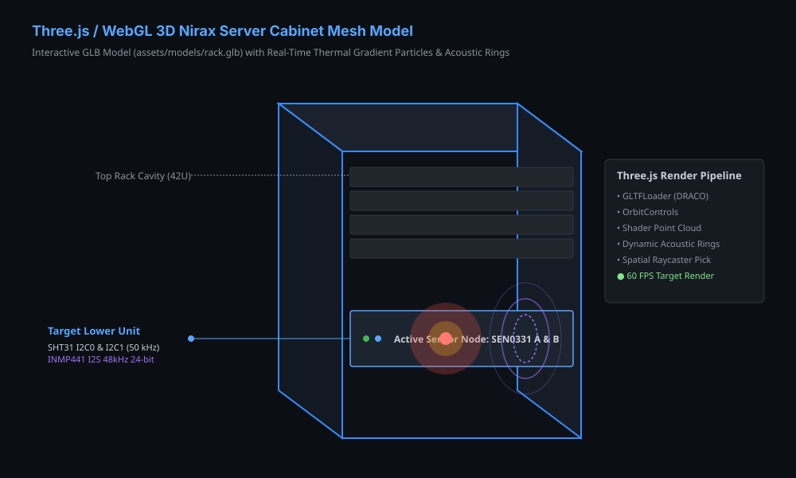
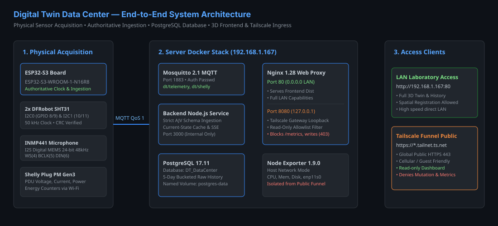
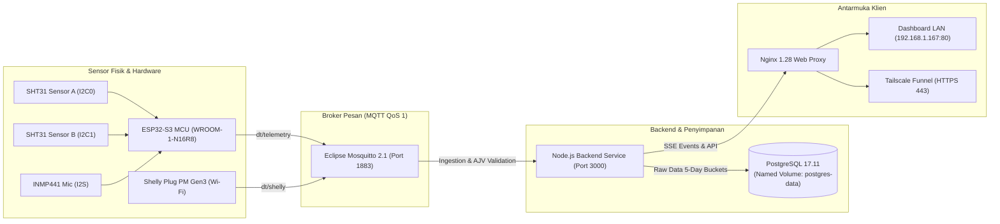
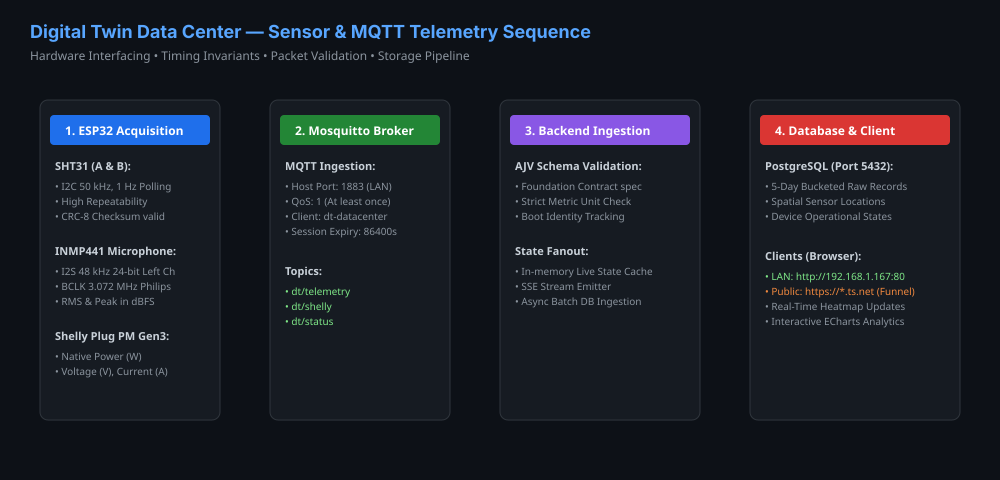
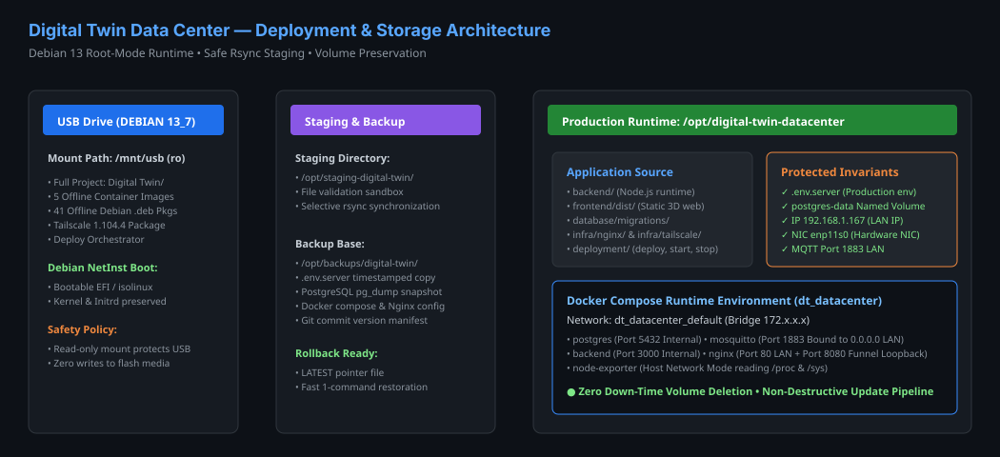
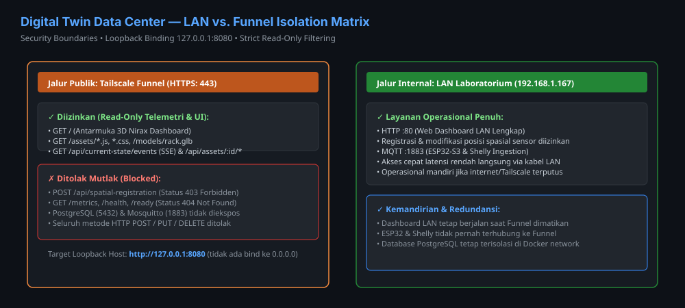

# Digital Twin Data Center

Sistem pemantauan lingkungan fisik dan telemetri rak server (_Single Cabinet 42U Data Center_) berbasis IoT, Three.js 3D WebGL, dan PostgreSQL. Sistem mengakuisisi telemetri lingkungan dan kelistrikan menggunakan mikrokontroler ESP32-S3 dan sensor presisi tinggi, mengalirkan data via MQTT QoS 1, serta menyajikan visualisasi digital twin interaktif secara lokal (LAN) maupun publik (Tailscale Funnel).

Identifier teknis basis data & repositori: `DT_DataCenter`  
Kontributor Resmi: **Ahmad Bagus Idkholus Surur**

---

## 1. Visualisasi Antarmuka & Arsitektur Sistem

### A. Dashboard Antarmuka 3D Nirax & Analitik Telemetri


### B. Model Geometri 3D Rak Server & Visualisasi Gradien



---

## 2. Arsitektur Sistem & Aliran Data

Sistem Digital Twin Data Center mengintegrasikan empat lapisan utama: akuisisi fisik, broker pesan, penyimpanan data deret waktu, dan visualisasi klien.





---

## 3. Fitur Utama Sistem

1. **Autoritatif & Presisi Tinggi (Hardware Invariant):**
   - Akuisisi suhu dan kelembaban menggunakan dua modul **DFRobot Fermion SHT31 SEN0331** pada bus I2C independen (I2C0 SDA 8/SCL 9 dan I2C1 SDA 10/SCL 11) pada clock 50 kHz dengan validasi CRC-8.
   - Analisis akustik menggunakan mikrofon digital **INMP441 I2S MEMS** 24-bit 48 kHz (WS 4, BCLK 5, DIN 6) yang menghitung magnitudo RMS dan Peak dalam dBFS.
   - Pengukuran daya nyata, tegangan, arus, dan akumulasi energi listrik melalui **Shelly Plug PM Gen3**.
2. **Visualisasi 3D WebGL / Three.js Nirax:**
   - Model rak server 42U (`assets/models/rack.glb`) interaktif dengan orbit controls, zoom, dan raycasting pemilihan unit server.
   - Partikel gradien termal (_point cloud particle field_) dan cincin gelombang akustik (_acoustic rings_) real-time.
3. **Penyimpanan Teroptimasi Deret Waktu:**
   - PostgreSQL 17 dengan skema telemetri terpartisi 5 hari (`database/migrations/`).
   - Backend memvalidasi setiap payload masuk dengan skema ketat AJV (_contract-first_).
4. **Isolasi Keamanan & Akses Publik:**
   - Dashboard LAN di laboratorium (`http://192.168.1.167:80`) beroperasi penuh secara mandiri.
   - Akses publik internet melalui **Tailscale Funnel** yang terenkripsi HTTPS otomatis tanpa membuka port router (NAT traversal).
   - Gateway publik terikat eksklusif ke loopback `127.0.0.1:8080` dengan kontrol allowlist ketat (hanya read-only, menolak akses administrasi, metrik, dan registrasi spasial).

---

## 4. Alur Komunikasi Sensor & MQTT Telemetri



### Tabel Spesifikasi Saluran Komunikasi

| Perangkat / Sumber | Antarmuka Fisik         | Frekuensi / Laju     | Topik MQTT     | Format Payload                         |
| :----------------- | :---------------------- | :------------------- | :------------- | :------------------------------------- |
| **SHT31 A & B**    | I2C0 & I2C1 (50 kHz)    | 1.0 Hz Polling       | `dt/telemetry` | JSON (temp, humidity, CRC)             |
| **INMP441**        | I2S Philips (3.072 MHz) | 48 kHz (24-bit)      | `dt/telemetry` | JSON (acoustic dBFS RMS/Peak)          |
| **Shelly Plug PM** | Wi-Fi (802.11 b/g/n)    | Periodik / RPC Event | `dt/shelly`    | JSON (power, voltage, current, energy) |
| **Node Exporter**  | Linux Host Network      | 15s Scrape           | `/metrics`     | OpenMetrics Prometheus format          |

---

## 5. Arsitektur Docker & Deployment



### Tabel Komponen Kontainer Docker (`docker/compose.yaml`)

| Layanan Kontainer   | Image Resmi                      | Port Host    | Visibilitas Jaringan                          | Fungsi                                      |
| :------------------ | :------------------------------- | :----------- | :-------------------------------------------- | :------------------------------------------ |
| **`postgres`**      | `postgres:17.11-alpine3.24`      | _Tidak ada_  | Internal Docker (`dt_datacenter_default`)     | Database relasional telemetri & konfigurasi |
| **`mosquitto`**     | `eclipse-mosquitto:2.1.2-alpine` | `1883`       | `0.0.0.0:1883` (LAN Saja)                     | Broker pesan MQTT terotentikasi             |
| **`backend`**       | `dt-datacenter-backend:local`    | `3010`       | `127.0.0.1:3010` (Loopback)                   | Service Node.js, validasi AJV, SSE emitter  |
| **`nginx`**         | `nginx:1.28-alpine`              | `80`, `8080` | `0.0.0.0:80` (LAN), `127.0.0.1:8080` (Funnel) | Reverse proxy web & gateway isolasi publik  |
| **`node-exporter`** | `prom/node-exporter:v1.9.0`      | `9100`       | Host Network (Terisolasi Firewall)            | Metrik utilisasi CPU, RAM, disk, dan NIC    |

---

## 6. Pemisahan Akses: LAN vs. Tailscale Funnel



- **Jalur LAN (`0.0.0.0:80`):** Menyediakan operasional penuh bagi workstation laboratorium, termasuk izin pembaruan posisi spasial sensor rak 3D.
- **Jalur Tailscale Funnel (`127.0.0.1:8080`):** Mengizinkan hanya request `GET` untuk asset statik dan pembacaan telemetri. Endpoint mutasi `/api/spatial-registration` diblokir (`403 Forbidden`) dan metrik sistem `/metrics` diblokir (`404 Not Found`).

---

## 7. Panduan Deployment Server Debian 13 (Mode ROOT `su -`)

Pekerjaan di server laboratorium menggunakan mode **ROOT murni** tanpa `sudo`.

### A. Persiapan USB

1. Hubungkan flashdisk USB ke server.
2. Masuk ke sesi root:
   ```bash
   su -
   ```
3. Identifikasi partisi USB (periksa TRAN=usb, LABEL=DEBIAN 13_7, dan SIZE; jangan berasumsi selalu /dev/sdb1):
   ```bash
   lsblk -o NAME,SIZE,TRAN,MODEL,FSTYPE,LABEL,MOUNTPOINTS
   mkdir -p /mnt/usb
   # Ganti /dev/sdX1 dengan nama partisi hasil identifikasi di atas
   mount -o ro /dev/sdX1 /mnt/usb
   cd "/mnt/usb/Digital Twin"
   ```

### B. Menjalankan Master Deployment Orchestrator

Jalankan entry point utama:

```bash
bash deployment/linux/deploy.sh
```

Pilih menu interaktif yang tersedia:

- **`3) Deploy Penuh`**: Melakukan preflight $\rightarrow$ backup database & `.env.server` $\rightarrow$ staging $\rightarrow$ sinkronisasi aman tanpa menimpa kredensial produksi $\rightarrow$ start kontainer aplikasi.
- **`5) Pasang Tailscale`**: Menginstal paket Tailscale 1.104.4 dari arsip offline di USB.
- **`6) Autentikasi Tailscale`**: Membuka sesi login interaktif Tailnet.
- **`7) Aktifkan Funnel`**: Membuka akses HTTPS publik aman ke dashboard read-only.
- **`8) Nonaktifkan Funnel`**: Menutup akses publik kapan saja tanpa mengganggu LAN.
- **`10) Rollback`**: Mengembalikan konfigurasi ke titik sebelum deployment jika diperlukan.

Panduan operasional lengkap:

- [Panduan Deployment](deployment/linux/README-DEPLOYMENT.md)
- [Manifest Media USB](deployment/linux/USB-MANIFEST.md)
- [Prosedur Pemulihan (Recovery)](deployment/linux/DEPLOYMENT-RECOVERY.md)
- [Kebijakan Mode Root](deployment/linux/ROOT-OPERATIONS.md)

---

## 8. Panduan Deployment Windows (Workstation / Dev)

Jalankan perintah dari PowerShell:

```powershell
# Jalankan container
& ./deployment/windows/start.ps1

# Periksa status
& ./deployment/windows/status.ps1

# Hentikan container
& ./deployment/windows/stop.ps1
```

Lihat panduan lengkap di [Dokumentasi Windows](docs/WINDOWS.md).

---

## 9. Status Pengujian Sistem

Pengujian otomatis dijalankan secara berkala pada workstation:

- **Unit & Integration Test:** `npm test` $\rightarrow$ **190 passed, 0 failed, 0 skipped** (100% lulus).
- **Linter & Syntax:** `npm run lint` $\rightarrow$ **0 error, 0 warning**.
- **Pemformatan Kode:** `npm run format:check` $\rightarrow$ Seluruh berkas bersih sesuai Prettier.
- **Build Frontend:** `npm run frontend:build` $\rightarrow$ Bundle Vite production selesai sukses.
- **Sintaks Skrip Shell:** Seluruh skrip shell (`.sh`) tervalidasi menggunakan `bash -n`.
- **Pemindaian Kredensial:** 0 token/password/auth-key bocor ke repositori Git.

---

## 10. Struktur Direktori Repositori

```text
DT_DataCenter/
├── api/                             Kontrak spesifikasi OpenAPI endpoint
├── assets/                          Aset 3D Blender, FBX, dan tekstur PBR
├── backend/                         Source code server Node.js & modul akuisisi
├── backups/                         Direktori arsip cadangan database
├── build/                           Artefak build firmware ESP32
├── config/                          Konfigurasi sistem & audit operasional
├── database/                        Skema fondasi SQL & migrasi tabel
├── deployment/                      Skrip deployment mandiri
│   ├── linux/                       Master orchestrator deploy.sh & skrip Debian
│   ├── tailscale/                   Skrip operasional Funnel & paket offline
│   ├── windows/                     Skrip operasional Windows PowerShell
│   └── resources/                   Image Docker (.tar) & paket offline (.deb)
├── docker/                          Docker Compose (utama, linux, windows, funnel)
├── docs/                            Dokumentasi arsitektur, contracts, dan operasi
│   └── assets/screenshots/          Diagram arsitektur & visualisasi sistem
├── firmware/                        Firmware Arduino/C++ ESP32-S3 & Shelly
├── frontend/                        Source code antarmuka 3D Nirax Three.js & dist
├── infra/                           Konfigurasi Nginx LAN & Gateway Tailscale
├── mqtt/                            Konfigurasi Mosquitto broker
├── observability/                   Konfigurasi Prometheus & Exporter
├── scripts/                         Helper script pengujian dan pemeliharaan
├── .env.example                     Template variabel lingkungan publik
├── AGENTS.md                        Aturan eksekusi rekayasa perangkat lunak
├── package.json                     Manifest dependensi & skrip proyek
└── README.md                        Dokumentasi utama proyek
```

---

## 11. Kontributor

Proyek Digital Twin Data Center dikembangkan dan dikelola oleh:

- **Ahmad Bagus Idkholus Surur** ([@Codingin02](https://github.com/Codingin02))
