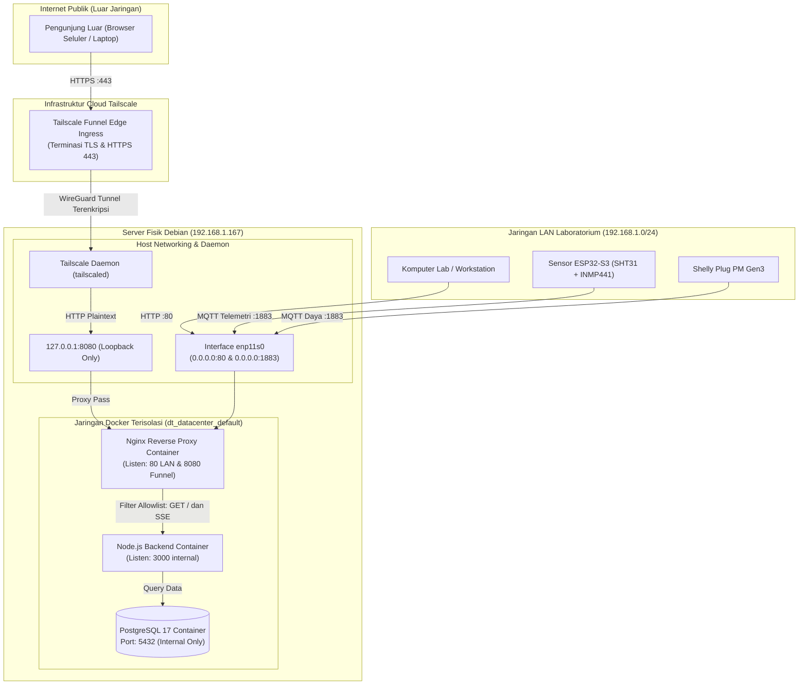

# Arsitektur Akses Publik & Isolasi Jaringan Digital Twin

Dokumen ini mendokumentasikan desain arsitektur teknis yang memisahkan akses internet publik dengan jaringan operasional internal Digital Twin Data Center.

---

## 1. Diagram Topologi Jaringan

---

## 2. Pemisahan Jalur: Publik vs LAN

Arsitektur Digital Twin membedakan dua jalur ingress secara fisik dan logis:

### A. Jalur Akses Publik (Tailscale Funnel)
- **Ingress:** Port `443` HTTPS publik diakhiri di edge cloud Tailscale.
- **Tunnel:** Diteruskan melalui terowongan WireGuard langsung ke proses `tailscaled` di server.
- **Egress Host:** `tailscaled` meneruskan paket ke alamat `127.0.0.1:8080`.
- **Target Gateway:** Container Nginx mendengarkan pada `127.0.0.1:8080` melalui konfigurasi `infra/nginx/funnel.conf`.
- **Filtering:**
  - Hanya mengizinkan method `GET`.
  - Hanya mengizinkan asset statik dashboard dan pembacaan metrik terkini.
  - Menolak rute `/api/spatial-registration` (`403 Forbidden`).
  - Menolak rute metrik infrastruktur `/metrics` (`404 Not Found`).

### B. Jalur Akses LAN Laboratorium
- **Ingress Dashboard:** Port `80` HTTP terbuka pada `0.0.0.0:80` untuk workstation laboratorium.
- **Ingress Telemetri Sensor:** Port `1883` MQTT terbuka pada `0.0.0.0:1883` untuk ESP32-S3 dan Shelly PM Gen3.
- **Fitur Lengkap:** Pengguna di LAN dapat melakukan seluruh operasi termasuk pendaftaran/pembaruan posisi spasial sensor rak 3D.

---

## 3. Isolasi Database & Layanan Sensitif

1. **PostgreSQL (5432):**
   Tidak memiliki konfigurasi binding port pada `docker/compose.yaml`. PostgreSQL hanya berada dalam jaringan virtual internal Docker `dt_datacenter_default`. Baik internet publik maupun jaringan LAN laboratorium tidak dapat melakukan koneksi langsung ke port 5432.
2. **Mosquitto MQTT (1883):**
   Hanya terikat pada port LAN untuk penerimaan sensor, dan **tidak didaftarkan pada Tailscale Serve maupun Funnel**.
3. **Backend Node.js (3000):**
   Hanya terikat secara internal dan berkomunikasi dengan Nginx melalui Docker DNS `http://dt_backend`.
4. **Node Exporter (9100):**
   Hanya digunakan untuk monitoring metrik host lokal dan tidak pernah diteruskan ke internet.

---

## 4. Matriks Keputusan Akses Endpoint

| Path HTTP | Method | Akses LAN (:80) | Akses Funnel (:8080) | Alasan Teknis |
| :--- | :--- | :--- | :--- | :--- |
| `/` | `GET` | Diizinkan (200) | Diizinkan (200) | Halaman antarmuka 3D Nirax |
| `/assets/*` | `GET` | Diizinkan (200) | Diizinkan (200) | Script JS dan style CSS |
| `/models/rack.glb` | `GET` | Diizinkan (200) | Diizinkan (200) | Model geometri 3D rak |
| `/api/current-state/events` | `GET` | Diizinkan (SSE) | Diizinkan (SSE) | Stream telemetri suhu/daya live |
| `/api/assets/:id/current-state`| `GET` | Diizinkan (200) | Diizinkan (200) | Data kondisi sensor per server |
| `/api/assets/:id/history` | `GET` | Diizinkan (200) | Diizinkan (200) | Grafik telemetri 5 hari |
| `/api/spatial-registration` | `POST` | **Diizinkan** | **DITOLAK (403)** | Mencegah modifikasi posisi fisik dari publik |
| `/metrics` | `GET` | **Diizinkan (Internal)**| **DITOLAK (404)** | Metrik sistem internal tidak boleh diintai |
| `/health`, `/ready` | `GET` | Diizinkan | **DITOLAK (404)** | Probe kesehatan internal tidak diekspos |
| Lainnya / Method selain GET | `*` | Sesuai API | **DITOLAK (404/403)**| Default Deny |
